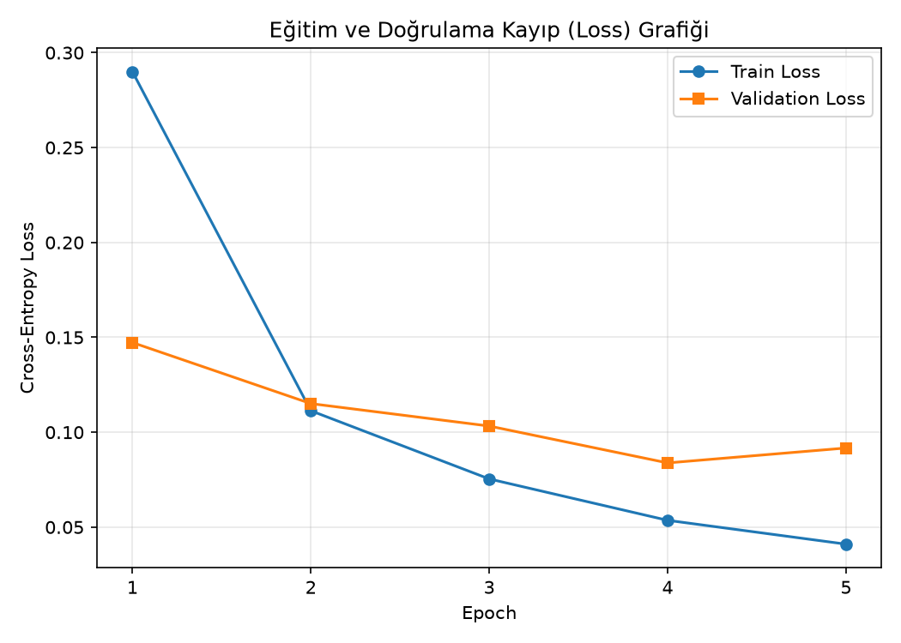
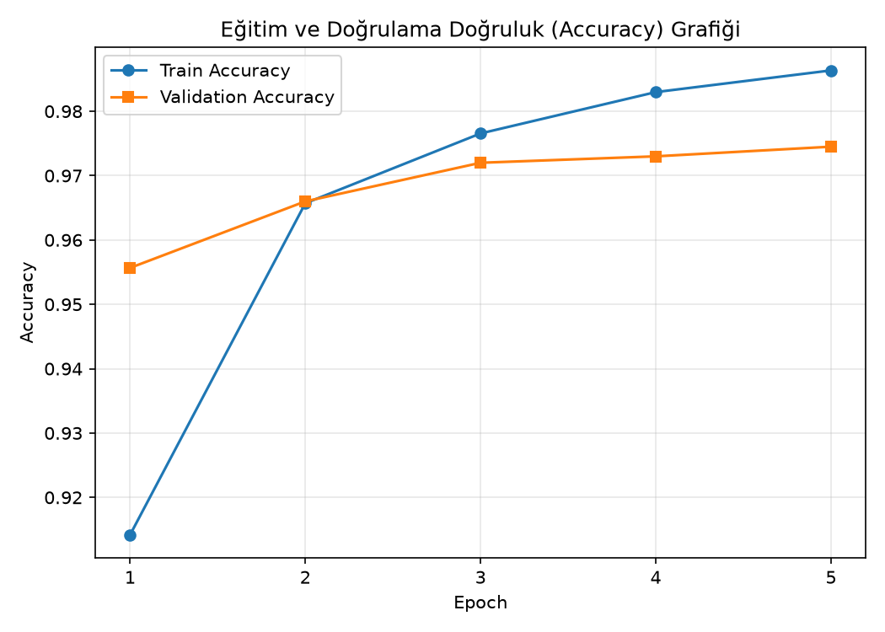
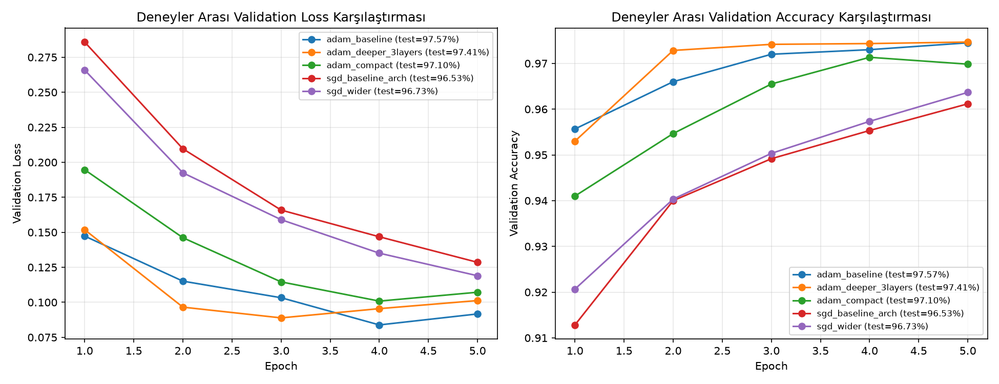
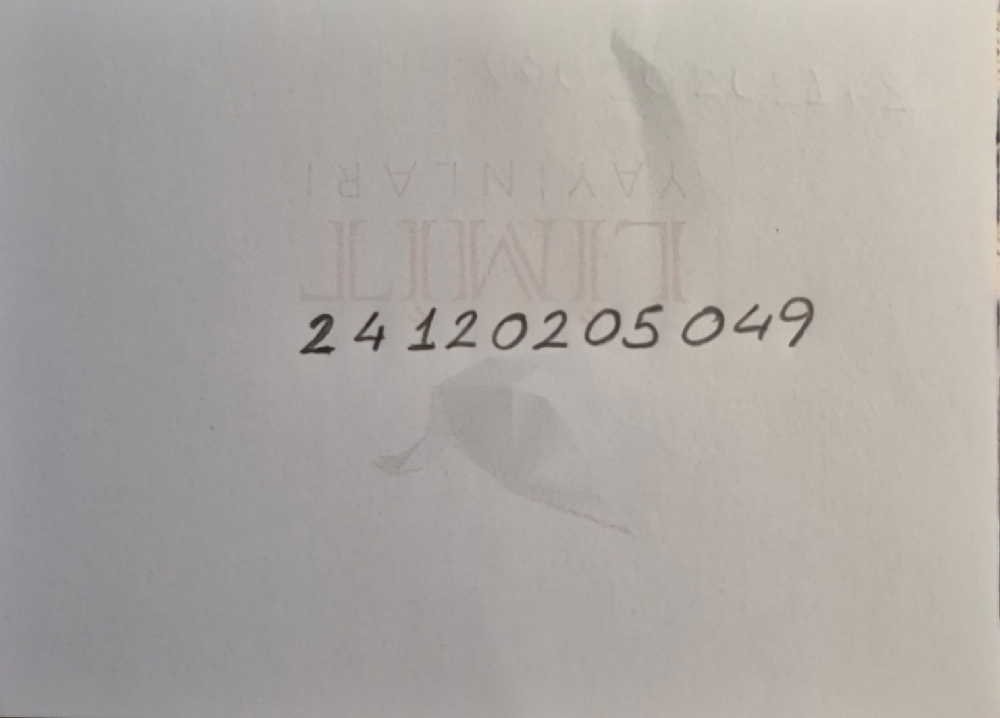
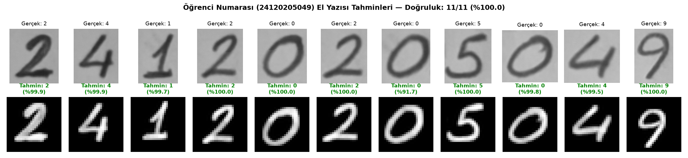
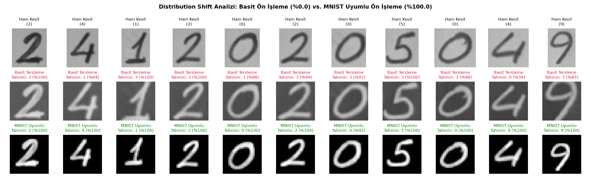

# MNIST Veri Seti ile MLP Tabanlı El Yazısı Rakam Tanıma

Bu proje, **CNN (Evrişimli Sinir Ağı) veya hazır eğitilmiş (pretrained) model kullanmadan**, yalnızca **Multi-Layer Perceptron (MLP)** mimarisiyle PyTorch kullanılarak MNIST veri seti üzerinde sıfırdan eğitilen el yazısı rakam tanıma sistemini, hiperparametre karşılaştırma deneylerini ve gerçek el yazısı öğrenci numarası (`24120205049`) üzerindeki değerlendirme sonuçlarını içerir.

---

## 1. Veri Seti ve Veri Bölme (Train / Validation / Test Ayrımı)

Deneylerde standart **MNIST** el yazısı rakam veri seti kullanılmıştır (`28 × 28` piksel, tek kanallı gri seviyeli, `0–9` arası 10 sınıf).

* **Eğitim (Train) Kümesi:** `54.000` görüntü (`train=True` kümesinin `%90`'ı, `seed=42` ile sabitlenmiş rastgele ayrım)
* **Doğrulama (Validation) Kümesi:** `6.000` görüntü (`train=True` kümesinin `%10`'u, `val_split=0.1`)
* **Test Kümesi:** `10.000` görüntü (`train=False` resmi MNIST test ayrımı)
* **Normalizasyon:** Tüm görüntüler `[0, 1]` aralığına ölçeklendikten sonra MNIST istatistikleri olan `mean = 0.1307`, `std = 0.3081` ile normalize edilmiştir.
* **Veri Sızıntısının Önlenmesi:** Test veri kümesi eğitim veya hiperparametre seçimi aşamalarında kesinlikle kullanılmamış; yalnızca eğitim tamamlandıktan sonra nihai performansı ölçmek için değerlendirilmiştir (`mnist_mlp/data.py` ve `mnist_mlp/train.py`).

---

## 2. Deney 1 – Temel MLP Modeli (`adam_baseline`)

### 2.1. Mimari ve Hiperparametre Yapılandırması

Temel model (`mnist_mlp/model.py` içindeki `MLPClassifier`), `28 × 28 = 784` boyutlu düzleştirilmiş (flattened) piksel vektörünü girdi olarak alır ve en az 2 gizli katman şartını sağlayacak şekilde aşağıdaki mimariye sahiptir:

```text
Girdi (28×28 -> Flatten: 784)
  ├─► Linear(784 -> 256) + ReLU   [1. Gizli Katman]
  ├─► Linear(256 -> 128) + ReLU   [2. Gizli Katman]
  └─► Linear(128 -> 10)           [Çıkış Katmanı (Logits)]
```

| Hiperparametre | Değer |
| :--- | :--- |
| **Girdi Boyutu** | `784` (`28 × 28` gri seviye) |
| **Gizli Katmanlar (`hidden_sizes`)** | `[256, 128]` (2 gizli katman) |
| **Aktivasyon Fonksiyonu** | `ReLU` |
| **Kayıp (Loss) Fonksiyonu** | `CrossEntropyLoss` |
| **Optimizer** | `Adam` |
| **Öğrenme Oranı (`lr`)** | `0.001` (`1e-3`) |
| **Batch Size** | `128` |
| **Epoch Sayısı** | `5` |
| **Validation Oranı (`val_split`)** | `0.10` (`54.000` Train / `6.000` Val / `10.000` Test) |
| **Rastgelelik Tohumu (`seed`)** | `42` |

### 2.2. Epoch Bazlı Eğitim ve Doğrulama Sonuçları

| Epoch | Training Loss | Validation Loss | Training Accuracy | Validation Accuracy |
| :---: | :---: | :---: | :---: | :---: |
| **1** | `0.2900` | `0.1473` | `%91.42` | `%95.57` |
| **2** | `0.1113` | `0.1151` | `%96.57` | `%96.60` |
| **3** | `0.0754` | `0.1033` | `%97.66` | `%97.20` |
| **4** | `0.0537` | `0.0837` | `%98.31` | `%97.30` |
| **5** | **`0.0410`** | **`0.0917`** | **`%98.64`** | **`%97.45`** |

* **Nihai Test Loss:** `0.0793`
* **Nihai Test Accuracy:** **`%97.57`**
* **Toplam Eğitim Süresi:** `17.22 saniye` (CPU)

### 2.3. Eğitim Süreci Kayıp (Loss) ve Doğruluk (Accuracy) Grafikleri

| Kayıp (Loss) Grafiği | Doğruluk (Accuracy) Grafiği |
| :---: | :---: |
|  |  |

**Loss ve Accuracy Yorumu:**
* İlk epoch'ta `Train Loss` (`0.2900`), epoch boyunca ağırlıklar henüz yakınsarken ölçüldüğü için epoch sonunda değerlendirilen `Validation Loss` (`0.1473`) değerinden daha yüksektir.
* 2. epoch'tan itibaren model hızla yakınsamış; 5. epoch sonunda eğitim doğruluğu `%98.64`, doğrulama doğruluğu `%97.45` ve test doğruluğu **`%97.57`** seviyesine ulaşmıştır.
* 4. ve 5. epoch arasında `Train Loss` düşmeye devam ederken (`0.0537 -> 0.0410`), `Validation Loss` değerinin `0.0837` civarında doyuma ulaşması, modelin 5 epoch sonunda yeterli kapasiteye ulaştığını ve daha uzun eğitimlerde hafif aşırı öğrenme (overfitting) eğiliminin başlayabileceğini göstermektedir.

---

## 3. Deney 2 – Model Yapılandırmalarının ve Hiperparametrelerin Karşılaştırılması

Optimizer seçimi (`Adam` vs. `SGD`), gizli katman sayısı (`2` vs. `3` katman) ve gizli katman genişliklerinin (`[128, 64]`, `[256, 128]`, `[512, 256]`) model performansı ve eğitim süresi üzerindeki etkisini analiz etmek amacıyla 5 farklı MLP yapılandırması aynı veri ayrımı (`seed=42`, `epochs=5`, `batch_size=128`) ile sıfırdan eğitilmiştir:

| Deney Adı | Gizli Katmanlar | Optimizer | LR | Train Loss | Val Loss | Train Acc | Val Acc | Test Loss | Test Acc | Süre (sn) |
| :--- | :--- | :---: | :---: | :---: | :---: | :---: | :---: | :---: | :---: | :---: |
| **`adam_baseline`** | `[256, 128]` | Adam | `0.001` | `0.0410` | **`0.0917`** | `%98.64` | `%97.45` | **`0.0793`** | **`%97.57`** | `17.22` |
| **`adam_deeper_3layers`** | `[512, 256, 128]` | Adam | `0.001` | **`0.0367`** | `0.1012` | **`%98.74`** | **`%97.47`** | `0.0860` | `%97.41` | `18.54` |
| **`adam_compact`** | `[128, 64]` | Adam | `0.001` | `0.0594` | `0.1072` | `%98.17` | `%96.98` | `0.1025` | `%97.10` | **`14.71`** |
| **`sgd_baseline_arch`** | `[256, 128]` | SGD | `0.050` | `0.1065` | `0.1285` | `%96.91` | `%96.12` | `0.1103` | `%96.53` | `15.37` |
| **`sgd_wider`** | `[512, 256]` | SGD | `0.050` | `0.0974` | `0.1189` | `%97.18` | `%96.37` | `0.1022` | `%96.73` | `18.64` |



### Hiperparametre Analizi

1. **Optimizer Etkisi (`Adam` vs. `SGD`):**
   * Aynı `[256, 128]` mimarisinde `Adam (lr=0.001)` `%97.57` test doğruluğuna ulaşırken, `SGD (lr=0.05)` 5 epoch sonunda `%96.53` doğrulukta kalmıştır. Parametre başına uyarlanabilir (adaptive) öğrenme oranı ve momentum kullanan Adam, sabit adımlı SGD'ye kıyasla çok daha hızlı yakınsamaktadır.
2. **Gizli Katman Genişliği (Kapasite) Etkisi (`[128, 64]` vs. `[256, 128]` vs. `[512, 256]`):**
   * Katman genişliği `[128, 64]`'e düşürüldüğünde (`adam_compact`), eğitim süresi `14.71` saniyeye inmiş ancak temsil kapasitesi azaldığı için test doğruluğu `%97.57`'den `%97.10`'a gerilemiştir.
   * SGD tarafında katmanları `[256, 128]`'den `[512, 256]`'ya genişletmek (`sgd_wider`) test doğruluğunu `%96.53`'ten `%96.73`'e yükseltmiştir.
3. **Derinlik Etkisi (2 Gizli Katman vs. 3 Gizli Katman):**
   * 3 gizli katmanlı `[512, 256, 128]` modeli (`adam_deeper_3layers`) en düşük eğitim kaybını (`0.0367`) ve en yüksek eğitim doğruluğunu (`%98.74`) elde etmesine rağmen, test doğruluğunda (`%97.41`) 2 gizli katmanlı `[256, 128]` modelinin (`%97.57`) hafif gerisinde kalmıştır. Bu durum, düzleştirilmiş 784 piksellik MNIST girdisi için `[256, 128]` kapasitesinin ideal genelleme dengesini kurduğunu göstermektedir.

---

## 4. Kendi El Yazısı Öğrenci Numarası (`24120205049`) ile Test ve Değerlendirme

### 4.1. Orijinal El Yazısı Görseli

Öğrenci numarası olan **`24120205049`** (11 hane), kağıt üzerine el yazısıyla yazılarak fotoğraflanmış ve `data/handwritten_digits/number.png` olarak kaydedilmiştir:



### 4.2. Görüntülerin MNIST Formatına Hazırlanması (`mnist_mlp/handwriting.py`)

Gerçek kamera görüntüsünü MNIST formatına (`28 × 28`, siyah zemin üzerine beyaz ve ortalanmış rakam) uyumlu hale getirmek için `mnist_mlp/handwriting.py` içerisinde aşağıdaki adımlar uygulanmıştır:

1. **Bölümlendirme (Segmentation):** Fotoğraftaki 11 rakam soldan sağa doğru bağlı bileşen projeksiyonu ve komşu rakam orta-nokta sınırlaması ile ayrı ayrı kesitlere ayrılmıştır.
2. **Gri Tonlama ve Arka Plan Bastırma:** Görüntüler tek kanallı gri seviyeye (`L`) dönüştürülmüştür. Kağıt rengi (`~168/255`) ve arka sayfadaki hafif yazı izlerini temizlemek için 75. yüzdelik dilim (percentile) tabanlı arka plan eşikleme uygulanarak kağıt zemini tam siyaha (`0`), mürekkep darbeleri ise parlak beyaza (`0–255`) dönüştürülmüştür.
3. **Oran Koruyarak Boyutlandırma ve Kütle Merkezi Hizalaması (`28 × 28`):** Resmi MNIST veri seti oluşturma protokolüne birebir uygun olarak her rakamın sıkı sınırlayıcı kutusu (bounding box) bulunmuş, en-boy oranı korunarak `20 × 20` piksel kutuya sığdırılmış ve **kütle merkezi (center of mass)** `(13.5, 13.5)` koordinatına gelecek şekilde `28 × 28` siyah tuvale yerleştirilmiştir. Hazırlanan tüm `28 × 28` görüntüler `data/handwritten_digits/digits_28x28/` klasörüne kaydedilmiştir.
4. **Normalizasyon:** `ToTensor()` sonrasında MNIST eğitim dağılımıyla aynı `mean=0.1307`, `std=0.3081` normalizasyonu uygulanmıştır.

### 4.3. Öğrenci Numarası (`24120205049`) Tahmin Sonuçları

Eğitilen temel MLP modeli (`adam_baseline`), hazırlanan 11 el yazısı rakamın **tamamını (`11/11`, `%100.0` doğruluk)** yüksek güven skorlarıyla doğru tahmin etmiştir:



| Hane Sırası | 28×28 MNIST Görseli | Gerçek Rakam | Model Tahmini | Güven Skoru (Softmax) | Sonuç |
| :---: | :---: | :---: | :---: | :---: | :---: |
| **1** |  | `2` | **`2`** | `%99.91` | Doğru |
| **2** |  | `4` | **`4`** | `%99.90` | Doğru |
| **3** |  | `1` | **`1`** | `%99.75` | Doğru |
| **4** |  | `2` | **`2`** | `%99.99` | Doğru |
| **5** |  | `0` | **`0`** | `%99.99` | Doğru |
| **6** |  | `2` | **`2`** | `%100.00` | Doğru |
| **7** |  | `0` | **`0`** | `%91.66` | Doğru |
| **8** |  | `5` | **`5`** | `%100.00` | Doğru |
| **9** |  | `0` | **`0`** | `%99.82` | Doğru |
| **10** |  | `4` | **`4`** | `%99.52` | Doğru |
| **11** |  | `9` | **`9`** | `%99.98` | Doğru |

* **Beklenen Öğrenci Numarası:** `24120205049`
* **Modelin Tahmin Ettiği Numara:** `24120205049`
* **El Yazısı Öğrenci Numarası Doğruluğu:** **`11 / 11 (%100.0)`**

---

## 5. Genel Değerlendirme ve Distribution Shift (Dağılım Kayması) Analizi

Bu ödevde eğitim verisi (MNIST) ile gerçek dünya verisi (cep telefonu kamerasıyla çekilen kağıt üzerindeki el yazısı) arasındaki **dağılım kayması (distribution shift)** doğrudan deneysel olarak gözlemlenmiştir:



1. **Neden Ham Kamera Görüntülerinde Dağılım Kayması Oluşur?**
   * **Arka Plan Farkı:** MNIST veri setinde arka plan pikselleri tam siyahtır (`0.0`). Oysa gerçek kağıt fotoğrafında kağıt yüzeyi gri tonlardadır (`~168/255`) ve arka sayfadaki baskı izleri görünmektedir. Görüntüye yalnızca basit renk tersleme (`255 - x`) uygulandığında arka plan `0` yerine `~87/255` değerinde parlak bir gürültü olarak kalır.
   * **Uzamsal Duyarlılık (MLP Mimarisi):** CNN'lerden farklı olarak MLP mimarisi görüntüyü `784` elemanlı sabit bir vektöre düzleştirir (`Flatten`). İlk gizli katmandaki `Linear(784, 256)` ağırlıkları, eğitim sırasında kenar piksellerinin her zaman `0` (arka plan) olmasına ve rakamın kütle merkezinin `(13.5, 13.5)` noktasında bulunmasına şartlanmıştır.
2. **Deneysel Kanıt (Basit Ön İşleme vs. MNIST Uyumlu Ön İşleme):**
   * Arka plan bastırma ve kütle merkezi hizalaması yapılmadan yalnızca `28 × 28` boyutlandırma + basit renk tersleme uygulandığında (`Basit Tersleme` satırı), arka plandaki gri pikseller tüm nöronları sürekli aktive ederek modelin neredeyse tüm rakamları `3` olarak tahmin etmesine (`31333333307`, **`0/11 — %0.0` doğruluk**) yol açmıştır.
   * Görüntüler arka plan eşikleme, `20 × 20` oran korumalı ölçekleme, `28 × 28` kütle merkezi ortalama ve MNIST normalizasyonu ile eğitim dağılımına hizalandığında (`MNIST Uyumlu` satırı), aynı MLP modelinin doğruluğu **`%0.0`'dan `%100.0`'a (`11/11`)** yükselmiştir.
   * Bu sonuç, gerçek dünya verilerini bir derin öğrenme modeline uygularken **veri ön işleme (preprocessing) ve dağılım hizalamasının** en az model mimarisi kadar kritik olduğunu açıkça ortaya koymaktadır.

---

## 6. Kurulum ve Çalıştırma

### 6.1. Ortam Kurulumu

```bash
python -m venv .venv
# Windows PowerShell:
.\.venv\Scripts\Activate.ps1
# Linux / macOS:
source .venv/bin/activate

pip install -r requirements.txt
```

### 6.2. Temel MLP Modelini Sıfırdan Eğitme

```bash
python -m mnist_mlp.train \
  --data-dir ./data \
  --output-dir ./outputs/run \
  --epochs 5 \
  --batch-size 128 \
  --optimizer adam \
  --lr 0.001 \
  --hidden-sizes 256 128 \
  --val-split 0.1 \
  --seed 42 \
  --save-checkpoint
```

### 6.3. Hiperparametre Karşılaştırma Deneylerini Çalıştırma

```bash
python -m mnist_mlp.experiments \
  --epochs 5 \
  --save-checkpoint \
  --experiments-output-dir ./outputs/experiments
```

### 6.4. El Yazısı Öğrenci Numarasını (`24120205049`) Değerlendirme

```bash
# Çok haneli öğrenci numarası fotoğrafını bölümlendirip 28x28 MNIST formatına dönüştürerek tahmin etme:
python -m mnist_mlp.handwriting \
  --checkpoint ./outputs/experiments/adam_baseline/checkpoint.pt \
  --student-number-image ./data/handwritten_digits/number.png \
  --expected-number 24120205049 \
  --output-dir ./outputs/handwriting

# Tekil 28x28 rakam görselleri üzerinde tahmin yapma:
python -m mnist_mlp.handwriting \
  --checkpoint ./outputs/experiments/adam_baseline/checkpoint.pt \
  data/handwritten_digits/digits_28x28/digit_01_2.png \
  data/handwritten_digits/digits_28x28/digit_02_4.png
```

### 6.5. Otomatik Testleri Çalıştırma

```bash
pytest -q
```
